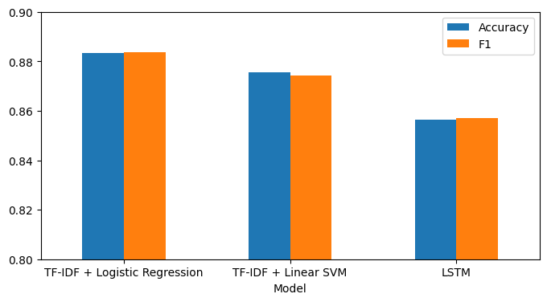
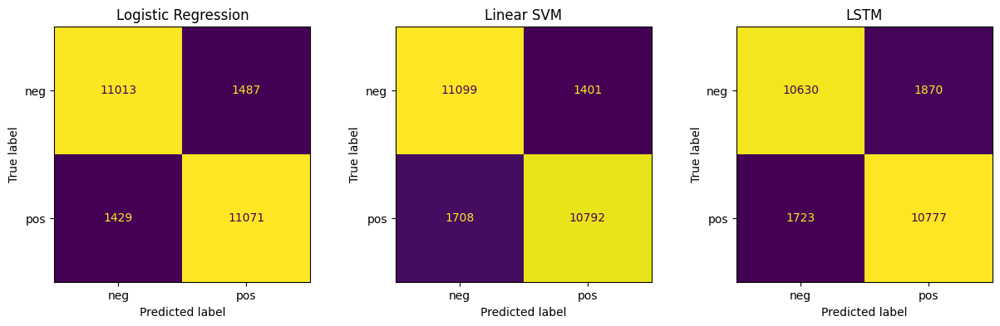

# Phân tích cảm xúc review phim IMDB bằng LSTM

**Họ tên:** Lê Hoàng Thảo Anh · **MSSV:** 24022252 

## Dữ liệu

- [IMDB Large Movie Review Dataset](https://huggingface.co/datasets/stanfordnlp/imdb): 50.000 review, 25.000 train và 25.000 test, mỗi nhãn chiếm 50%.
- Tiền xử lý: bỏ thẻ HTML, chuyển về chữ thường, chỉ giữ chữ cái.

## Mô hình

| Mô hình | Biểu diễn văn bản | Cấu hình chính |
| --- | --- | --- |
| Logistic Regression | TF-IDF (1–2 gram, 50.000 đặc trưng) | `max_iter=1000` |
| Linear SVM | TF-IDF (1–2 gram, 50.000 đặc trưng) | `LinearSVC()` |
| LSTM | Embedding 128 chiều, 20.000 từ, `max_len=300` | LSTM(64) → Dropout(0.5) → Dense(1), Adam, EarlyStopping |

## Kết quả trên tập test (25.000 review)

| Mô hình | Accuracy | Precision | Recall | F1 | Thời gian train (s) |
| --- | --- | --- | --- | --- | --- |
| TF-IDF + Logistic Regression | **0.8834** | 0.8816 | 0.8857 | **0.8836** | 0.8 |
| TF-IDF + Linear SVM | 0.8756 | 0.8851 | 0.8634 | 0.8741 | 0.4 |
| LSTM | 0.8471 | 0.8333 | 0.8678 | 0.8502 | 34.0 (GPU T4) |




## Kết luận

1. TF-IDF + Logistic Regression cho kết quả tốt nhất (88,3%) và train nhanh hơn LSTM khoảng 40 lần.
2. LSTM đạt 84,7% và bị overfit sau 1–2 epoch, vì phải học embedding từ đầu với chỉ 20.000 review. Việc cắt review ở 300 từ cũng làm mất thông tin của các review dài.
3. Ưu điểm của LSTM là học được thứ tự từ, nên có thể tốt hơn khi có nhiều dữ liệu hơn hoặc dùng embedding train sẵn như GloVe.

## Cách chạy

Mở notebook bằng Google Colab (chọn Runtime → GPU) rồi chọn **Runtime → Run all**:

[](https://colab.research.google.com/drive/1xNcC9jf8IYOMTNBdKDRR2p_bBRwY-cz1?usp=sharing)

## Cấu trúc thư mục

```
├── imdb_sentiment_lstm.ipynb   # notebook chính
├── README.md
└── results/
    ├── comparison.csv          # bảng kết quả
    ├── comparison.png          # biểu đồ so sánh
    └── confusion_matrices.png  # confusion matrix 3 mô hình
```
